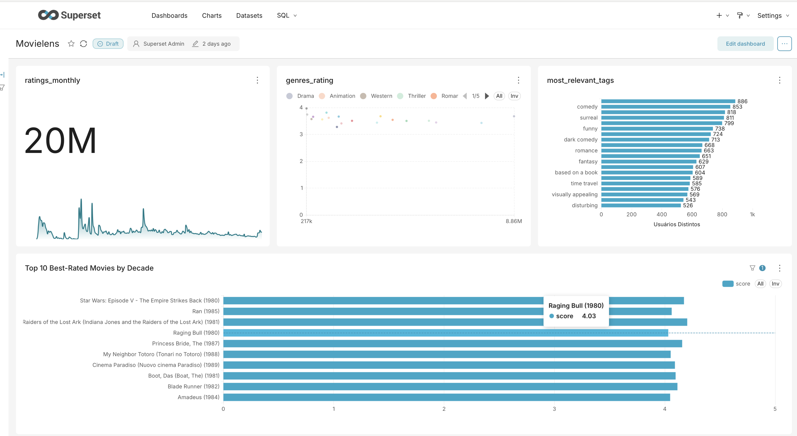
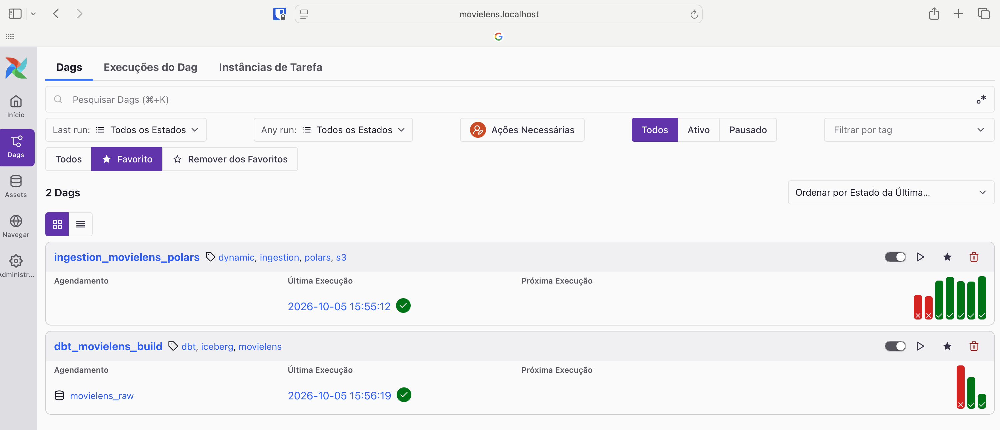
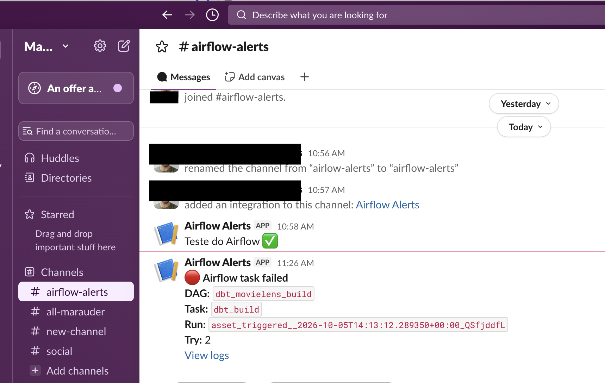

# MovieLens Lakehouse

This project turns 20 million movie ratings into insights about what people watch, how they rate it and how they describe it. It is also a hands-on exercise in data engineering: every stage of the pipeline, from ingestion to the dashboard, applies a common practice of the field, such as a lakehouse on an open table format, layered modeling, incremental loads, SCD2 history, data tests, event-driven orchestration, alerting, least-privilege access and infrastructure as code.

The data comes from [MovieLens 20M](https://grouplens.org/datasets/movielens/20m/), a public dataset from GroupLens with ratings, user tags and the Tag Genome for about 27,000 movies. The pipeline is built as a lakehouse on S3:

- **Airflow (Astro)** ingests the raw files and orchestrates the pipeline.
- **dbt + DuckDB** transform the data and write **Apache Iceberg** tables to S3.
- **AWS Glue Data Catalog** registers the tables.
- **Amazon Athena** queries them for **Apache Superset** dashboards.
- **Terraform** manages the AWS infrastructure.



## Table of contents

- [Architecture](#architecture)
- [Repository layout](#repository-layout)
- [Getting started](#getting-started)
- [Infrastructure as Code (Terraform)](#infrastructure-as-code-terraform)
- [Ingestion](#ingestion)
- [Orchestration: Airflow (Astro)](#orchestration-airflow-astro)
- [Transformation: dbt + DuckDB + Iceberg](#transformation-dbt--duckdb--iceberg)
- [Visualization: Apache Superset + Athena](#visualization-apache-superset--athena)
- [Operations](#operations)
- [Roadmap](#roadmap)

## Architecture

```
MovieLens zip (grouplens.org)
        │
        ▼  Airflow: ingestion_movielens_polars (Polars)
S3 raw/bronze ── Parquet (s3://ao-eng/movielens/raw/...)
        │
        ▼  Airflow: dbt_movielens_build (triggered by the movielens_raw Asset)
DuckDB :memory: ── SQL engine, persists nothing
        │
        ├─ staging ── in-memory views (cleaning, typing, snake_case)
        │
        ▼
S3 warehouse ── Iceberg tables + snapshots (SCD2)
        ▲
   AWS Glue Data Catalog (database: movielens)
        │
        ▼
Amazon Athena ── query engine (workgroup: movielens)
        │
        ▼
Apache Superset ── dashboards
```

The project does not use a `.duckdb` file. DuckDB runs entirely in memory and acts only as the SQL engine. Everything that needs to persist is written to S3 in **Iceberg** format and cataloged in **Glue**.

dbt writes the tables with DuckDB, and Superset reads the same tables with Athena. Two different engines work on the same data with no copies, which is the core idea of a lakehouse built on an open table format. Since the tables are registered in Glue, any other engine (Athena, Spark, DuckDB in DBeaver) can query them without going through dbt.

| Layer | Format | Location | dbt materialization |
|---|---|---|---|
| raw/bronze | Parquet | `s3://ao-eng/movielens/raw/` | `sources` |
| staging | none (not persisted) | memory | `view` |
| warehouse | Iceberg | `s3://ao-eng/movielens/warehouse/` + Glue | `iceberg_table` (custom) or `incremental` |
| snapshots | Iceberg | `s3://ao-eng/movielens/warehouse/` + Glue | `snapshot` |

### Stack

| Component | Version / detail |
|---|---|
| Astro Runtime | 3.3 (Airflow 3) |
| Ingestion | Polars, PyArrow, s3fs |
| dbt | dbt-core 1.12 + dbt-duckdb 1.11, `dbt_utils` 1.3.0 |
| DuckDB | 1.5.3 or later (required for `MERGE`, `UPDATE` and `DELETE` on Iceberg), extensions `httpfs`, `aws`, `iceberg` |
| Catalog and storage | AWS Glue Data Catalog (Iceberg REST endpoint) + S3 |
| Query layer for BI | Amazon Athena |
| BI | Apache Superset via docker compose, with the `pyathena` driver |
| Infrastructure | Terraform >= 1.11, AWS provider ~> 6.0 |

## Repository layout

```
.
├── dags/
│   ├── ingestion_movielens_polars.py   # main ingestion: zip → Parquet on S3 (updates the movielens_raw Asset)
│   ├── ingestion_movielens_duckdb.py   # alternative ingestion with DuckDB + zipfs
│   ├── dbt_movielens.py                # runs dbt build after each ingestion
│   └── exampledag.py                   # Astro example DAG
├── dbt_movielens/
│   ├── models/staging/                 # in-memory views over the raw Parquet files
│   ├── models/warehouse/               # dim_, fct_ and mart_ models (Iceberg)
│   ├── snapshots/                      # snap_tags (SCD2)
│   ├── seeds/                          # seed_movie_release_dates.csv
│   ├── macros/                         # Iceberg/Glue overrides and custom materialization
│   ├── tests/                          # singular tests
│   ├── dbt_project.yml
│   └── profiles.yml
├── infra/terraform/                    # S3, Glue, Athena and IAM
├── tests/dags/                         # DAG integrity tests (Astro)
├── Dockerfile                          # Astro Runtime + isolated dbt virtualenv
├── requirements.txt                    # Python packages for the Airflow image
└── airflow_settings.yaml               # local-only Airflow connections/variables (ignored by git)
```

## Getting started

### Prerequisites

- [Astro CLI](https://www.astronomer.io/docs/astro/cli/install-cli) and Docker
- Terraform >= 1.11
- AWS CLI with a `terraform` profile (for the infrastructure) and credentials for the pipeline user

### 1. Provision the infrastructure

```bash
cd infra/terraform
terraform init
terraform plan
terraform apply
```

See [Infrastructure as Code](#infrastructure-as-code-terraform) for what is created.

### 2. Configure the environment

Create a `.env` file at the project root (ignored by git and by Docker builds). Astro loads it into every Airflow container:

```
AWS_ACCESS_KEY_ID=<pipeline user access key>
AWS_SECRET_ACCESS_KEY=<pipeline user secret key>
AWS_DEFAULT_REGION=us-east-1
AWS_ACCOUNT_ID=<account id>
SLACK_WEBHOOK_URL=<optional, incoming webhook for failure alerts>
```

`AWS_ACCOUNT_ID` is used by `profiles.yml` to attach the Glue catalog. `SLACK_WEBHOOK_URL` is optional: without it, failure alerts are skipped.

### 3. Start Airflow

```bash
astro dev start
```

This builds the image from the `Dockerfile` (including the `dbt_venv` virtualenv) and starts five containers:

- **Postgres**: Airflow's metadata database (`localhost:5432/postgres`, user and password `postgres`)
- **Scheduler**: monitors and triggers tasks
- **DAG Processor**: parses the DAGs
- **API Server**: serves the Airflow UI and API
- **Triggerer**: runs deferred tasks

When the containers are ready, the command prints the Airflow UI URL. Recent Astro CLI versions use a `<project>.localhost` address behind a local proxy, which Safari only resolves with an entry in `/etc/hosts`. In any browser, the UI is also available directly at http://localhost:8080.

If a port is already in use, [stop the existing containers or change the port](https://www.astronomer.io/docs/astro/cli/troubleshoot-locally#ports-are-not-available-for-my-local-airflow-webserver).

### 4. Run the pipeline

In the Airflow UI, trigger **`ingestion_movielens_polars`**. When it succeeds, **`dbt_movielens_build`** starts automatically.

To run dbt outside Airflow (with the same environment variables exported):

```bash
cd dbt_movielens
dbt deps --profiles-dir .
dbt build --profiles-dir .
```

### 5. Start Superset

Follow [Visualization: Apache Superset + Athena](#visualization-apache-superset--athena).

### Deploying to Astronomer

To deploy to a Deployment on Astronomer, see the [Astronomer documentation](https://www.astronomer.io/docs/astro/deploy-code/).

## Infrastructure as Code (Terraform)

All AWS resources live in [infra/terraform/](infra/terraform/), using the `terraform` AWS profile and `us-east-1` by default.

| File | Resources |
|---|---|
| `backend.tf` | S3 backend at `s3://ao-eng/terraform-state/movielens/terraform.tfstate`, encrypted, with native S3 locking (`use_lockfile`) |
| `s3.tf` | `ao-eng` bucket (`prevent_destroy`), public access block, SSE-S3 encryption, versioning and lifecycle rules |
| `glue.tf` | `movielens` Glue database with `LocationUri` `s3://ao-eng/movielens/warehouse/` |
| `athena.tf` | `movielens` workgroup with enforced settings, results location and a per-query scan limit |
| `iam.tf` + `policies/` | `engineer` (pipeline) and `movielens-superset` (BI) users and their policies |
| `imports.tf` | `import` blocks for resources that existed before Terraform (bucket, Glue database, IAM users) |
| `variables.tf` | `region`, `bucket_name`, `athena_bytes_scanned_cutoff` (1 GB by default) |
| `outputs.tf` | Athena workgroup name and Superset IAM user name |

Design notes:

- **Terraform manages the Glue database, never its tables.** Tables are created and replaced by dbt.
- **Bucket lifecycle**: Athena results expire after 7 days, noncurrent object versions after 30 days, and incomplete multipart uploads after 7 days. Versioning is kept because the bucket also stores the Terraform state.
- **No access keys in Terraform.** Keys are created manually with `aws iam create-access-key`, so secrets never land in the state file.

### IAM permissions

Each component has its own IAM user with only the permissions it needs.

| User | Role | Glue | S3 | Athena |
|---|---|---|---|---|
| `engineer` | pipeline (Airflow + dbt) | read/write tables in `movielens` | read/write `movielens/*` | none |
| `movielens-superset` | BI (Superset) | read-only | read the warehouse, write Athena results | only the `movielens` workgroup |
| `terraform` | infrastructure | manage the `movielens` database | bucket settings and the state prefix | manage the `movielens` workgroup |

The pipeline user (`movielens-dbt` policy) gets:

- **Glue**, scoped to the `movielens` database: `GetCatalog`, `GetDatabase`, `GetDatabases`, `GetTable`, `GetTables`, `GetPartitions`, `CreateTable`, `UpdateTable`, `DeleteTable`
- **S3**, scoped to the `movielens/` prefix: `ListBucket`, `GetBucketLocation`, `GetObject`, `PutObject`, `DeleteObject`, `AbortMultipartUpload`, `ListMultipartUploadParts`

`CreateDatabase` is intentionally not granted: if a model points to a schema that does not exist, the build fails instead of creating new databases in Glue. The pipeline has no Athena access either, since dbt writes Iceberg through the Glue endpoint and never queries Athena.

## Ingestion

**`ingestion_movielens_polars`** (manual trigger) downloads `ml-20m.zip`, reads each CSV with Polars and writes it as Snappy-compressed Parquet to:

```
s3://ao-eng/movielens/raw/<table>/<table>.parquet
```

Tables: `movies`, `ratings`, `tags`, `links`, `genome-scores`, `genome-tags`. Each run overwrites the previous files. When the task succeeds, it updates the `movielens_raw` Asset, which triggers dbt.

**`ingestion_movielens_duckdb`** is an alternative implementation that reads the CSVs directly inside the remote zip with DuckDB's `zipfs` community extension and writes them with `COPY ... TO 's3://...'`. It does not update the Asset, so it does not trigger dbt.

## Orchestration: Airflow (Astro)

The pipeline runs on Astro (Airflow 3) with two DAGs connected by an Asset:

```
ingestion_movielens_polars          dbt_movielens_build
┌──────────────────────────┐        ┌──────────────────────────┐
│ extract_zip_to_s3        │ ─────▶ │ dbt_build                │
│ (outlets: movielens_raw) │ Asset  │ (schedule: movielens_raw)│
└──────────────────────────┘        └──────────────────────────┘
```



In the Airflow UI, `dbt_movielens_build` shows `movielens_raw` as its schedule instead of a cron expression.

- **`dbt_movielens_build`** is scheduled on the `movielens_raw` Asset, so it runs right after every successful ingestion. If the ingestion fails, the Asset is not updated and dbt never runs on incomplete data.
- dbt runs from a dedicated virtual environment (`dbt_venv`, built in the `Dockerfile`), isolated from Airflow's own dependencies.
- `max_active_runs=1` and a 1-hour `execution_timeout` prevent overlapping or stuck builds.

### Why a single `BashOperator` instead of Cosmos

[Astronomer Cosmos](https://github.com/astronomer/astronomer-cosmos) is the most common way to run dbt Core on Airflow. Its main feature is rendering **one Airflow task per dbt model**, each one running `dbt run --select <model>` in its own process.

That model does not fit this architecture. DuckDB runs **in memory**, and the staging layer is made of in-memory views. Each Cosmos task would start with an empty database, so a warehouse model would fail because the staging views it depends on were created, and discarded, in a different task.

The project therefore runs the whole `dbt build` in a single task, so every model and test shares the same DuckDB process:

```python
BashOperator(
    task_id="dbt_build",
    bash_command=f"{DBT_EXECUTABLE} deps --profiles-dir . && {DBT_EXECUTABLE} build --profiles-dir .",
    cwd=DBT_PROJECT_DIR,
)
```

A plain `BashOperator` was chosen over Cosmos's single-task operator (`DbtBuildLocalOperator`): with only one task, Cosmos would add a dependency without its main benefit.

**Trade-off:** failures are visible at the task level in Airflow, while the failing model or test is identified in the dbt logs. Since `dbt build` exits with an error when any model or test fails, the task fails and the Slack alert fires in both cases.

**Alternative considered:** switching the staging models to `ephemeral` (inlined as CTEs) would make each model self-contained and allow one task per model with Cosmos. It would require moving the staging tests to the sources, since dbt does not run tests on ephemeral models.

### Failure alerts

Retries and alerts are set in the DAG's `default_args` (1 retry after 5 minutes). After the last retry, an `on_failure_callback` posts the DAG, task, run ID and a link to the logs to a Slack channel through an incoming webhook. The webhook URL comes from the `SLACK_WEBHOOK_URL` environment variable; without it, the DAG runs normally and simply skips the alert.



#### Slack setup

1. **Workspace**: create a free workspace at [slack.com/get-started](https://slack.com/get-started).
2. **Channel**: create a channel for the alerts, e.g. `#airflow-alerts`.
3. **App**: at [api.slack.com/apps](https://api.slack.com/apps), choose **Create New App > From scratch** and select the workspace.
4. **Webhook**: in the app, open **Incoming Webhooks**, turn it on, click **Add New Webhook to Workspace**, pick the channel and copy the URL.
5. **Airflow**: add the URL to the Astro `.env` and run `astro dev restart`:

```
   SLACK_WEBHOOK_URL=https://hooks.slack.com/services/...
```

The webhook URL works as a credential: keep it out of the repository.

## Transformation: dbt + DuckDB + Iceberg

The dbt project lives in [dbt_movielens/](dbt_movielens/).

### Connection setup (`profiles.yml`)

The Glue catalog is attached to DuckDB under the alias `dbt_movielens`. For dbt, this alias is the `database`, and the Glue database (`movielens`) is the `schema`.

```yaml
attach:
  - path: "{{ env_var('AWS_ACCOUNT_ID') }}"
    alias: dbt_movielens
    type: iceberg
    options:
      endpoint_type: glue
      purge_requested: "false"   # quoted on purpose: dbt-duckdb drops boolean options set to false
```

Credentials come from the AWS `credential_chain` (profile or environment variables). No keys are stored in the repository.

### Models

| Layer | Model | Materialization | Description |
|---|---|---|---|
| staging | `stg_movies`, `stg_ratings`, `stg_tags`, `stg_links`, `stg_genome-scores`, `stg_genome-tags` | `view` | Read the raw Parquet files, rename to snake_case and fix types |
| warehouse | `dim_movies` | `iceberg_table` | Movies with genres array, release year and decade |
| warehouse | `dim_users` | `iceberg_table` | Distinct users from ratings and tags |
| warehouse | `dim_genome_tags` | `iceberg_table` | Tag Genome dictionary |
| warehouse | `dim_movies_with_tags` | `ephemeral` | Movies joined with their genome tags |
| warehouse | `fct_ratings` | `incremental` | One row per rating, loaded by `rating_timestamp` |
| warehouse | `fct_genome_scores` | `iceberg_table` | Movie × tag relevance (non-zero only) |
| warehouse | `mart_top_movies` | `iceberg_table` | Bayesian weighted rating and rank per decade |
| warehouse | `mart_ratings_monthly` | `iceberg_table` | Rating volume and average per month |
| warehouse | `mart_genres_rating` | `iceberg_table` | Rating volume and average per genre |
| warehouse | `mart_snap_tags` | `iceberg_table` | Current user tags ranked by distinct users |
| warehouse | `mart_movie_tag_profile` | `iceberg_table` | Pivot of selected genome tags per movie |
| warehouse | `mart_movie_releases` | `iceberg_table` | Ratings enriched with the release date seed |
| snapshots | `snap_tags` | `snapshot` | SCD2 history of user tags |

Supporting resources: the `seed_movie_release_dates` seed, the `relevance_score_test` singular test, the `no_nulls_in_columns` macro and the `dbt_utils` package.

### Modeling decisions

- **Staging as in-memory views**: nothing is persisted. When running a partial selection, include the ancestors (`dbt build -s +model`).
- **Large tables as `incremental`** (e.g. `fct_ratings`): they are not rebuilt on every run and accumulate Iceberg snapshots, which enables time travel.
- **Small dimensions and marts as `iceberg_table`**: rebuilt on every run, since recomputing them is cheap.
- **Snapshots with `+full_refresh: false`**: the SCD2 history cannot be rebuilt from the raw layer, so it is never recreated automatically.
- **A single Glue database** (`movielens`), with prefixes to tell tables apart: `dim_`, `fct_`, `mart_`, `snap_`.
- **snake_case columns from staging on**: Glue stores column names in lowercase, so mixed-case names would break the incremental schema check.

### Glue (Iceberg REST) limitations and workarounds

Integrating dbt-duckdb with the Glue Iceberg endpoint took a few adjustments, because dbt-duckdb has no special handling for attached Iceberg catalogs and Glue has its own restrictions.

| Limitation | Symptom | Workaround |
|---|---|---|
| Glue requires a `location` when creating an Iceberg table and does not inherit the database `LocationUri` | `Location information cannot be null` | The `duckdb__create_table_as` macro injects `WITH ('location' = ...)` (`macros/iceberg_overrides.sql`) |
| Glue rejects `purgeRequested=true` on drop, and DuckDB sends `true` by default with `ENDPOINT_TYPE glue` | `PurgeRequested cannot be true for Glue iceberg tables` | `purge_requested: "false"` in the `attach` block |
| Glue does not support renaming tables, and dbt's `table` materialization builds `__dbt_tmp` and then renames it | `RenameTable endpoint is not supported for Glue Catalog` | Custom `iceberg_table` materialization (DROP + CREATE) and `+full_refresh: false` |
| DuckDB does not yet support `DROP TABLE ... CASCADE` on Iceberg, and dbt-duckdb always uses `CASCADE` | `DROP TABLE CASCADE is not supported for Iceberg tables` | The `duckdb__drop_relation` macro drops without `CASCADE` for the Iceberg catalog |
| Glue stores column names in lowercase, and the incremental schema check is case-sensitive | `source and target schemas ... are out of sync` (`userId` vs `userid`) | All columns use snake_case from the staging layer on |

### Project macros

- **`macros/iceberg_overrides.sql`**: overrides `create_table_as` (adds `location`) and `drop_relation` (removes `CASCADE`). It only affects relations in the catalog set by `var('iceberg_catalog')`.
- **`macros/iceberg_table.sql`**: the `iceberg_table` materialization, a replacement for `table` that does not rely on renames. It is not atomic: the table is unavailable for a few seconds during the build.
- **`macros/generate_schema_name.sql`**: uses `+schema` exactly as configured, so it matches the Glue database name (without the `main_` prefix).

Variables used by the macros (`dbt_project.yml`):

```yaml
vars:
  iceberg_catalog: dbt_movielens
  iceberg_warehouse_path: s3://ao-eng/movielens/warehouse
```

Each table is written to `<iceberg_warehouse_path>/<model>/<invocation_id>/`. The `invocation_id` makes the path unique per run, so a rebuilt table never shares a folder with its previous version.

## Visualization: Apache Superset + Athena

Superset runs locally via docker compose (from the [official repository](https://github.com/apache/superset)) and queries the warehouse through Athena. Athena reads the Iceberg tables straight from Glue, so Superset needs no Iceberg-specific setup.

### Why Athena instead of DuckDB

| | Athena | DuckDB |
|---|---|---|
| Iceberg reads | native, through Glue | requires an `ATTACH` on every connection |
| Superset setup | driver + URI | driver + a Python hook in `superset_config.py` |
| Cost | USD 5 per TB scanned (cents at this volume) | free |

Athena was chosen for its simplicity and because it shows a second engine reading the same tables dbt writes.

### Setup

All steps below run in the Superset repository.

**1. Athena driver.** Create `docker/requirements-local.txt`:

```
pyathena[pandas]
```

Superset's bootstrap script installs this file automatically when the containers start.

**2. AWS credentials.** Superset uses the read-only `movielens-superset` IAM user, created by Terraform. Create its access key manually:

```bash
aws iam create-access-key --user-name movielens-superset
```

Then create `docker/.env-local` (ignored by git) with that key:

```
AWS_ACCESS_KEY_ID=<access_key>
AWS_SECRET_ACCESS_KEY=<secret_key>
AWS_DEFAULT_REGION=us-east-1
```

Every compose service (`superset`, `superset-init`, `superset-worker`, `superset-worker-beat`) already reads this file, since its `env_file` entry is declared as optional (`required: false`). Optionally, pin the image version in the same file instead of using `latest-dev`:

```
TAG=<stable Superset version>
```

**3. Volumes.** Superset does not need to mount anything from S3. Docker cannot mount buckets as volumes, and Athena reads the data straight from the bucket. The volumes stay with the project defaults:

```yaml
x-superset-volumes:
  &superset-volumes
  - ./docker:/app/docker
  - superset_home:/app/superset_home
```

**4. Start Superset.**

```bash
docker compose -f docker-compose-image-tag.yml up -d
```

`docker-compose-image-tag.yml` uses the prebuilt image. The default `docker-compose.yml` is Superset's own development environment, which builds the frontend and is much slower. Open http://localhost:8088 (default user and password: `admin` / `admin`).

**5. Athena connection.** Under **Settings > Database Connections > + Database > Amazon Athena**, use this URI:

```
awsathena+rest://@athena.us-east-1.amazonaws.com/movielens?work_group=movielens
```

- **No user or password in the URI**: PyAthena falls back to the default AWS credential chain, which means the variables in `docker/.env-local`.
- **`movielens`**: the Glue database used as the default schema.
- **`work_group=movielens`**: the project workgroup, created by Terraform. It enforces the results location (`movielens/athena-results/`) and a per-query scan limit, so the URI needs no `s3_staging_dir`.

**6. Validation and datasets.** In **SQL Lab**, check the connection:

```sql
SELECT * FROM movielens.dim_movies LIMIT 10;
```

Then register the tables under **Datasets > + Dataset** (Athena database, `movielens` schema) and build the charts on top of them.

### Dashboard

The Superset dashboard has five charts. Each one reads from a small, pre-aggregated mart instead of the fact tables, so the heavy aggregation runs once in DuckDB during `dbt build` and Athena only scans a few KB per chart.

| Chart | Type | Source mart | Question it answers |
|---|---|---|---|
| Top 10 Best-Rated Movies by Decade | horizontal bar | `mart_top_movies` | Which movies are rated highest within each decade? |
| Top 10 Most-Rated Movies by Decade | horizontal bar | `mart_top_movies` | Which movies were watched (rated) the most within each decade? |
| Ratings Monthly | line | `mart_ratings_monthly` | How did rating activity evolve over time? |
| Genres Rating | bubble (scatter) | `mart_genres_rating` | Are niche genres rated higher than mainstream ones? |
| Most Relevant Tags | horizontal bar | `mart_snap_tags` | How do users describe movies? |


A native filter on `release_decade` drives both Top 10 charts, so they always compare the same set of movies: placed side by side, they show that the most watched movies are not always the best rated.

#### Design decisions

- **Bayesian weighted rating** for the best-rated ranking: a plain average puts obscure movies with a handful of 5-star ratings at the top. The weighted rating pulls each movie toward the global average in proportion to how few ratings it has (`m = 1,000`), the same approach IMDb uses for its Top 250. The ranking per decade (`rank_in_decade`) is computed in dbt with `row_number()`, since Superset's row limit applies to the whole result, not per group.
- **Line for monthly activity**: about 240 monthly points read better as a continuous trend than as bars.
- **Bubble chart for genres**: average rating vs. number of ratings (log scale) per genre. Both metrics sit on the axes, so bubble size is kept constant to avoid encoding the same value twice. A donut chart was ruled out because averages are not parts of a whole.
- **Bars instead of a word cloud for tags**: font size is a poor channel for comparing values, and long words look more important than short ones. Tags are normalized (`lower(trim(tag))`), read only from current SCD2 records (`dbt_valid_to is null`), and ranked by distinct users, so a single very active user cannot inflate a tag.
- **Timestamps**: MovieLens stores Unix epoch seconds. They are converted with `make_timestamp(col::bigint * 1000000)`, which does not depend on the session time zone, unlike casting `to_timestamp()` to a plain `TIMESTAMP`.

### Notes

- **Lowercase columns**: with the project's snake_case convention, names show up in Superset exactly as they are in dbt.
- **Iceberg snapshots**: Athena always reads the current version of a table. For time travel, use `FOR VERSION AS OF <snapshot_id>` or `FOR TIMESTAMP AS OF <timestamp>` in SQL Lab.
- **Cost**: Athena charges by data scanned. In this project that means cents, but dashboards with frequent auto-refresh multiply the number of queries. Prefer Superset's cache over short refresh intervals. The workgroup scan limit is the safety net.

## Operations

### Exploring the Iceberg tables

Any DuckDB client (e.g. DBeaver) can read the tables by attaching the same catalog:

```sql
LOAD aws; LOAD iceberg; LOAD httpfs;
ATTACH '<account_id>' AS dbt_movielens (TYPE iceberg, ENDPOINT_TYPE glue, PURGE_REQUESTED false);

-- versions (snapshots) of a table
SELECT * FROM iceberg_snapshots(dbt_movielens.movielens.fct_ratings);

-- time travel
SELECT count(*) FROM dbt_movielens.movielens.fct_ratings AT (VERSION => <snapshot_id>);
```

### Things to watch

- **Orphan files**: since drops do not purge, older versions of rebuilt tables remain in S3. The cost is negligible at this volume, but old folders under `warehouse/<model>/` can be cleaned up, keeping only the one referenced by the table's current `metadata_location` in Glue.
- **Rebuilding an incremental model**: with `full_refresh` disabled, delete the table in Glue (`aws glue delete-table`) and run dbt again.
- **Region**: the bucket, Glue and the DuckDB secret must be in the same region. A mismatched region causes S3 redirect errors or Glue permission errors.

## Roadmap

- [x] **Orchestration**: run `dbt build` from an Airflow (Astro) DAG right after the ingestion DAG that lands the raw files in S3.
- [x] **Alerting**: send a Slack message when a task or a dbt test fails.
- [x] **Infrastructure as code**: manage the S3 bucket, the Glue database, the Athena workgroup and the IAM policies with Terraform.
- [ ] **Per-model orchestration**: switch staging to `ephemeral` and render one task per model with Cosmos.
- [ ] **Cache invalidation**: refresh the Superset cache after each successful `dbt build`.
- [ ] **Movie similarity**: cosine similarity over the Tag Genome vectors (`array_cosine_similarity`) to build a "similar movies" mart.
